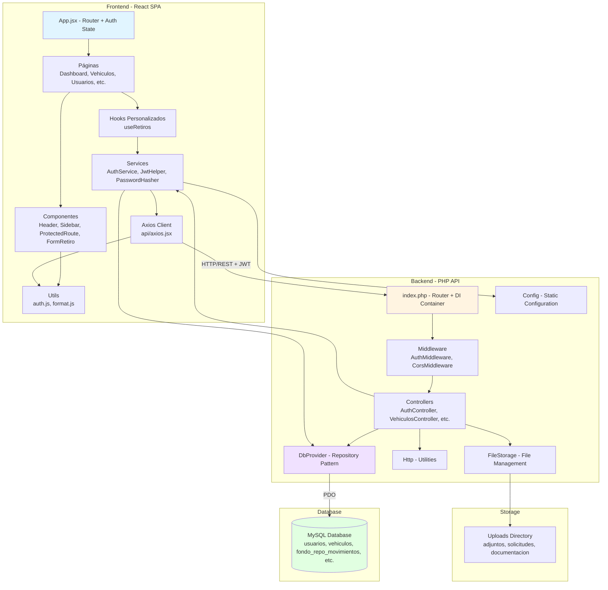

# Arquitectura del Sistema - Fondo de Reposicion Gacela

## 1. Arquitectura General

### 1.1 Patrón Arquitectónico

El proyecto sigue un **patrón de arquitectura cliente-servidor con separación clara por capas (n-tier)**:

- **Frontend**: Aplicación React 19 (SPA) con Vite
- **Backend**: API REST PHP 8.2+ con framework Slim 4
- **Base de datos**: MySQL vía PDO

### 1.2 Separación Frontend-Backend

| Capa | Ubicación | Tecnología | Propósito |
|------|-----------|------------|-----------|
| Frontend | `Frontend/` | React 19 + Vite + Tailwind CSS | Interfaz de usuario |
| Backend | `api/` | PHP 8.2 + Slim 4 | API REST |
| Database | MySQL | MySQL 5.7+ / MariaDB 10.3+ | Persistencia de datos |

### 1.3 Tipo de Arquitectura

- **NO es microservicios**: Es una arquitectura monolítica modular
- **Por capas**: Clara separación de responsabilidades en backend
- **Componentes**: Frontend organizado en componentes React reutilizables

---

## 2. Backend - Capas Identificadas

### 2.1 Punto de Entrada (`api/index.php`)

**Ubicación:** <ref_file file="C:\Users\jmolano\Fondo_Reposicion_Gacela_V1_SideGround\api\index.php" />

**Responsabilidades:**
- Configuración de la aplicación Slim 4
- Registro de middleware (CORS, routing, body parsing)
- Definición de rutas API
- Inyección de dependencias manual
- Manejo de archivos estáticos (uploads)

**Evidencia de código** (líneas 70-82):
```php
$db = new DbProvider();
$authService = new AuthService($db);

$authCtrl = new AuthController($authService);
$dashboardCtrl = new DashboardController($db);
$vehiculosCtrl = new VehiculosController($db);
$retirosCtrl = new RetirosController($db);
$usuariosCtrl = new UsuariosController($db);
$rolesCtrl = new RolesController($db);
$fondoCtrl = new FondoCargueController($db);
$solicitudesCtrl = new SolicitudesController($db);
$documentacionCtrl = new DocumentacionController($db);
$adjuntosCtrl = new AdjuntosController();
```

---

### 2.2 Capa de Controladores (`api/src/Controllers/`)

**Controladores identificados:**
- `AuthController.php` - Autenticación
- `VehiculosController.php` - Gestión de vehículos
- `RetirosController.php` - Retiros del fondo
- `UsuariosController.php` - Gestión de usuarios
- `RolesController.php` - Roles y permisos
- `DashboardController.php` - Métricas del dashboard
- `FondoCargueController.php` - Cargue de datos
- `SolicitudesController.php` - Solicitudes
- `DocumentacionController.php` - Documentación
- `AdjuntosController.php` - Archivos adjuntos

**Patrón de inyección de dependencias** (Constructor Injection):

Ejemplo de `AuthController.php` (líneas 12-16):
```php
final class AuthController
{
    public function __construct(private AuthService $auth)
    {
    }
}
```

---

### 2.3 Capa de Servicios (`api/src/`)

**Servicios identificados:**
- `AuthService.php` - Lógica de autenticación
- `JwtHelper.php` - Generación/validación de tokens JWT
- `PasswordHasher.php` - Hashing de contraseñas
- `FileStorage.php` - Gestión de archivos adjuntos
- `Http.php` - Utilidades HTTP (respuestas JSON, parsing)
- `Config.php` - Configuración centralizada

---

### 2.4 Capa de Middleware (`api/src/Middleware/`)

**Middleware identificados:**
- `AuthMiddleware.php` - Autenticación y autorización por permisos
- `CorsMiddleware.php` - Manejo de CORS

**Patrón Middleware implementado:**

`AuthMiddleware.php` (líneas 17-21):
```php
final class AuthMiddleware implements MiddlewareInterface
{
    public function __construct(private ?string $permiso = null)
    {
    }
```

Método factory estático (líneas 51-54):
```php
public static function require(?string $permiso = null): self
{
    return new self($permiso);
}
```

---

### 2.5 Capa de Acceso a Datos (`DbProvider.php`)

**Ubicación:** <ref_file file="C:\Users\jmolano\Fondo_Reposicion_Gacela_V1_SideGround\api\src\DbProvider.php" />

**Patrón Repository implementado:**

Clase final con PDO encapsulado (líneas 7-28):
```php
final class DbProvider
{
    private \PDO $pdo;

    public function __construct()
    {
        $this->pdo = new \PDO(
            Config::dsn(),
            Config::dbUser(),
            Config::dbPass(),
            [
                \PDO::ATTR_ERRMODE => \PDO::ERRMODE_EXCEPTION,
                \PDO::ATTR_DEFAULT_FETCH_MODE => \PDO::FETCH_ASSOC,
                \PDO::ATTR_EMULATE_PREPARES => false,
            ]
        );
    }
```

**Métodos de acceso a datos:**
- `obtenerVehiculoPorPlaca()` - Consulta de vehículo
- `obtenerFondosMensuales()` - Fondos por mes
- `obtenerSaldoDisponible()` - Saldo de retiros
- `obtenerUsuarioPorNombre()` - Usuario por nombre
- `obtenerPermisosPorUsuario()` - Permisos de usuario
- `crearRetiro()` - Crear retiro
- `obtenerDashboardMetricas()` - Métricas del dashboard

---

### 2.6 Conexión entre Capas (Backend)

**Flujo de datos:**
```
Cliente HTTP
    ↓
index.php (Router + Middleware)
    ↓
AuthMiddleware (Validación JWT)
    ↓
Controller (Inyección de dependencias)
    ↓
Service (Lógica de negocio)
    ↓
DbProvider (Acceso a datos via PDO)
    ↓
MySQL Database
```

---

## 3. Frontend - Organización

### 3.1 Punto de Entrada y Rutas (`App.jsx`)

**Ubicación:** <ref_file file="C:\Users\jmolano\Fondo_Reposicion_Gacela_V1_SideGround\Frontend\src\App.jsx" />

**Estado de autenticación** (líneas 19-28):
```jsx
const [isAuth, setIsAuth] = useState(isAuthenticated());

const handleLogin = () => {
  setIsAuth(true);
};

const handleLogout = () => {
  localStorage.removeItem("token");
  setIsAuth(false);
};
```

---

### 3.2 Capa de Páginas (`Frontend/src/pages/`)

**Páginas identificadas:**
- `Dashboard.jsx` - Dashboard principal con métricas
- `Login.jsx` - Página de login
- `Vehiculos.jsx` - Consulta de vehículos
- `Usuarios.jsx` - Gestión de usuarios
- `Roles.jsx` - Gestión de roles y permisos
- `CargueFondo.jsx` - Cargue de datos del fondo
- `NuevaSolicitud.jsx` - Creación de solicitudes
- `Solicitudes.jsx` - Lista de solicitudes
- `Documentacion.jsx` - Documentación
- `Unauthorized.jsx` - Página de no autorizado

---

### 3.3 Capa de Componentes (`Frontend/src/components/`)

**Componentes identificados:**
- `Header.jsx` - Cabecera de la aplicación
- `Sidebar.jsx` - Barra lateral de navegación
- `Navbar.jsx` - Barra de navegación
- `ProtectedRoute.jsx` - Componente de ruta protegida
- `ProtectedButton.jsx` - Botón protegido por permisos
- `Resumen.jsx` - Componente de resumen
- `DetalleAnual.jsx` - Detalle anual
- `Retiros/FormRetiro.jsx` - Formulario de retiros
- `Retiros/ListaRetiros.jsx` - Lista de retiros
- `Retiros/VehiculoRetiros.jsx` - Retiros por vehículo
- `Solicitudes/ListaSolicitudes.jsx` - Lista de solicitudes
- `Solicitudes/NuevaDocumentacion.jsx` - Nueva documentación
- `Documentacion/ListaDocumentacion.jsx` - Lista de documentación

---

### 3.4 Capa de Servicios (`Frontend/src/Services/`)

**Servicios identificados:**
- `api.js` - Cliente Axios configurado
- `authService.js` - Servicios de autenticación
- `dashboardService.js` - Servicios del dashboard
- `retiroService.js` - Servicios de retiros
- `rolesService.js` - Servicios de roles
- `usuariosService.js` - Servicios de usuarios
- `vehiculosService.js` - Servicios de vehículos

---

### 3.5 Capa de Utilidades (`Frontend/src/Utils/`)

**Utilidades identificadas:**
- `auth.js` - Funciones de autenticación (decodificación JWT, permisos)
- `format.js` - Formateo de moneda y datos

---

## 4. Patrones de Diseño Identificados

### 4.1 Inyección de Dependencias (Constructor Injection)

Implementado en backend con clases finales:

```php
final class AuthController
{
    public function __construct(private AuthService $auth)
    {
    }
}
```

---

### 4.2 Patrón Singleton

NO se implementa el patrón Singleton clásico. Sin embargo:
- `Config` es una clase estática con métodos estáticos (pseudo-singleton)
- `DbProvider` se instancia una vez en `index.php` y se reutiliza

---

### 4.3 Patrón Middleware

Implementado explícitamente con PSR-15 en `AuthMiddleware.php`:

```php
final class AuthMiddleware implements MiddlewareInterface
{
    public function process(Request $request, RequestHandler $handler): Response
    {
        // Validación de JWT y permisos
        return $handler->handle($request);
    }
}
```

---

### 4.4 Patrón Repository

Implementado en `DbProvider.php` que encapsula acceso a datos:

```php
final class DbProvider
{
    public function obtenerVehiculoPorPlaca(string $placa): ?array
    {
        // SQL query encapsulado
    }
}
```

---

### 4.5 Patrón Factory

Implementado en `AuthMiddleware`:

```php
public static function require(?string $permiso = null): self
{
    return new self($permiso);
}
```

---

### 4.6 Patrón Strategy

Implementado en `PasswordHasher` para soportar múltiples estrategias de hashing:

```php
public static function verificar(string $password, string $storedHash, string $storedSalt): bool
{
    // Estrategia 1: BCrypt (nuevos usuarios)
    if ($storedHash !== '' && str_starts_with($storedHash, '$2')) {
        return password_verify($password, $storedHash);
    }

    // Estrategia 2: HMAC-SHA512 (usuarios heredados de .NET)
    if ($storedSalt === '' || $storedHash === '') {
        return false;
    }
    $saltBytes = base64_decode($storedSalt, true);
    $computed = base64_encode(hash_hmac('sha512', $password, $saltBytes, true));
    return hash_equals($storedHash, $computed);
}
```

---

## 5. Principios SOLID

### 5.1 Single Responsibility Principle (SRP)

**Cumplido en backend:**
- `DbProvider`: Solo acceso a datos
- `AuthService`: Solo lógica de autenticación
- `AuthController`: Solo manejo de requests HTTP
- `JwtHelper`: Solo operaciones JWT
- `PasswordHasher`: Solo hashing de contraseñas
- `FileStorage`: Solo gestión de archivos
- `Http`: Solo utilidades HTTP

**Cumplido en frontend:**
- `dashboardService.js`: Solo llamadas API del dashboard
- `authService.js`: Solo operaciones de autenticación
- `auth.js`: Solo utilidades de decodificación JWT
- `ProtectedRoute.jsx`: Solo protección de rutas

---

### 5.2 Open/Closed Principle (OCP)

**Parcialmente cumplido:**
- Los controllers están cerrados para modificación pero abiertos para extensión vía herencia (aunque usan `final`)
- El middleware se extiende via parámetros en el constructor
- Los permisos se agregan sin modificar el middleware base

---

### 5.3 Liskov Substitution Principle (LSP)

**No aplicable directamente:**
- No hay jerarquía de herencia significativa
- La mayoría de clases son `final`
- No hay polimorfismo basado en herencia

---

### 5.4 Interface Segregation Principle (ISP)

**Cumplido via PSR-7:**
- `MiddlewareInterface` define solo un método: `process()`
- `RequestInterface` y `ResponseInterface` están bien segregados
- Los controllers implementan métodos específicos por cada operación

---

### 5.5 Dependency Inversion Principle (DIP)

**Cumplido parcialmente:**
- Los controllers dependen de abstracciones (`DbProvider`, `AuthService`) en lugar de implementaciones concretas
- Sin embargo, `DbProvider` es una clase concreta, no una interfaz
- No hay interfaces explícitas definidas para los repositories

---

## 6. Gestión del Estado en Frontend

### 6.1 Context API

**AuthContext.jsx existe pero está vacío** (archivo de 0 bytes)

**Estado de autenticación manejado en App.jsx** con useState local.

**NO se usa Context API** para estado global. Se usa:
- `useState` local en componentes
- `localStorage` para persistencia
- Props drilling para pasar callbacks

---

### 6.2 Hooks Personalizados

**Hook identificado:** `useRetiros.js`

**Implementación:**
```jsx
export function useRetiros() {
  const [retiros, setRetiros] = useState([]);
  const [loading, setLoading] = useState(false);
  const [error, setError] = useState(null);

  const cargarRetiros = async (placa) => {
    try {
      setLoading(true);
      const data = await obtenerRetirosPorPlaca(placa);
      setRetiros(data);
    } catch (e) {
      setError(e.response?.data || "Error al cargar retiros");
    } finally {
      setLoading(false);
    }
  };

  const registrarRetiro = async (retiro) => {
    return await crearRetiro(retiro);
  };

  return {
    retiros,
    loading,
    error,
    cargarRetiros,
    registrarRetiro
  };
}
```

---

### 6.3 Estado Global vs Local

**Estado LOCAL:**
- `useState` en cada componente para datos específicos

**Estado GLOBAL (via localStorage):**
- Token JWT
- Nombre completo del usuario
- Usuario
- Rol
- Permisos (decodificados del token)

**No hay Redux, Zustand, o Context API** para estado global complejo.

---

## 7. Diagrama de Arquitectura


